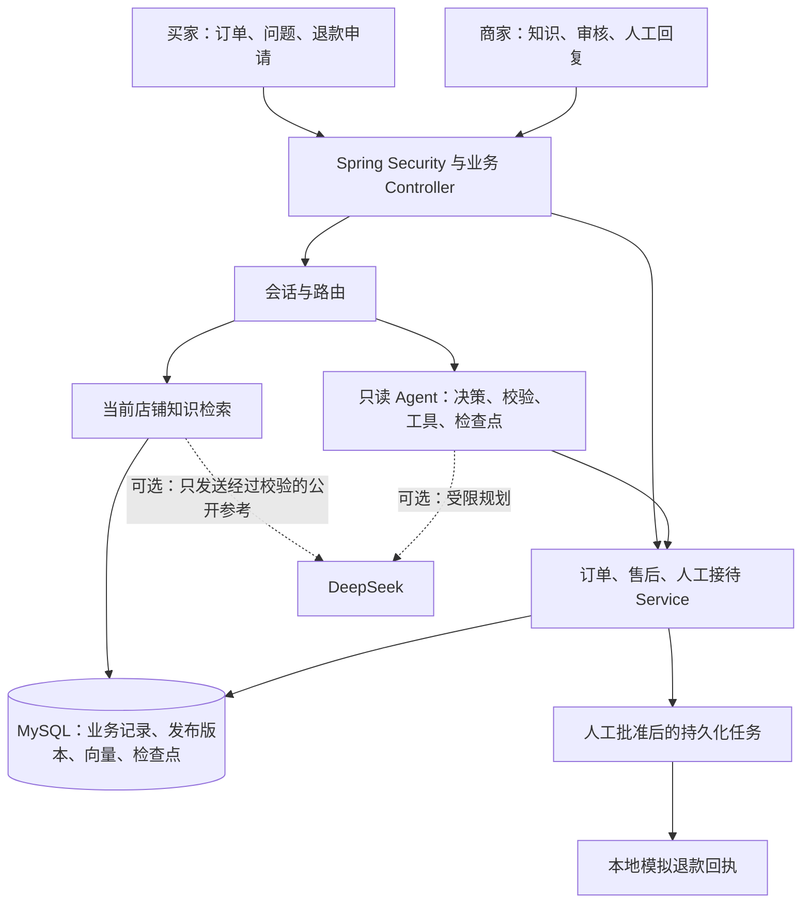

# 从业务流程理解 SupportFlow

SupportFlow 是一个 Java / Spring Boot + Vue 的店铺客服学习项目。买家查自己的订单、物流和售后进度；商家维护店铺知识、审核退款申请并接待人工咨询。模型参与问题理解和受限的只读决策，身份、权限、业务状态和资金边界由 Java 控制。

阅读顺序：[五分钟演示](demo-guide.md) → 本文的四条调用链 → [面试表达](interview-guide.md)。拿到交付包先读 [交付安装](delivery-install.md)；改源码沿用 [前端开发说明](../frontend/README.md) 和 [部署实验说明](../deploy/README.md)。

## 先认清系统里的人和数据

| 使用者 | 想完成的事 | 服务端据什么决定能否操作 |
| --- | --- | --- |
| 买家 | 查订单、按商品名定位订单、看物流、申请退款、联系人工 | 登录得到的 `buyerId`、当前 `shopId`、订单归属和当前状态 |
| 商家员工 | 审核售后、维护知识、接待咨询 | 账号类型、独立能力权限、有效员工身份和明确的店铺授权 |
| 运维人员 | 查看健康状态和指标 | 独立运维认证；业务账号不能替代运维账号 |
| DeepSeek | 识别意图或提出下一步只读动作；可选筛选公开证据 | Java 限定输入、动作和参数，模型输出不产生权限 |

`shopId` 说明正在咨询哪家店，不能证明这笔订单属于登录人。两家店可以有相同订单号，所以订单查询同时需要店铺、认证买家和订单号。商家也不能仅凭“是员工”读取所有店铺。

这是有清晰业务分区的单体应用：一个 Spring Boot 后端、一个 Vue 前端、MySQL 持久化。实验部署另有 Nginx 和 Prometheus。容器数量不等于微服务数量。

## 四条可以顺着代码讲清楚的业务链

### 1. 买家查看一笔订单

输入是认证身份、URL 中的 `shopId` 和 `orderNo`。`OrderController.getOwnedOrder` 调用 `OrderQueryService.getOwnedOrder`，再调用 `JdbcSupportOrderRepository.findByOrderNo`。SQL 同时限定 `tenant_id`、`buyer_id` 和 `order_no`，并排除已有买家删除标记的订单。输出是当前可访问的订单卡片，包括已有的商品快照和图片字段；历史缺失字段保持为空。

这里没有把整张订单交给模型判断归属。按商品名查单也复用店铺与买家范围；多笔匹配时展示候选，由买家选择。列表以实际返回记录的 ID 做游标，多读一行判断还有没有下一页。

代码：[入口](../src/main/java/dev/supportflow/order/api/controller/OrderController.java)、[业务校验与分页](../src/main/java/dev/supportflow/order/application/OrderQueryService.java)、[SQL](../src/main/java/dev/supportflow/order/infrastructure/persistence/jdbc/JdbcSupportOrderRepository.java)。

### 2. 买家选中订单后问“查物流”

前端传消息和选中的订单号，`ConversationController.send` → `ConversationService.send`。会话服务先预留本轮处理权，已有成功结果可以返回保存的快照；执行模型或工具期间不持有外层数据库事务。随后进入 `ConversationContextEngine` 和 `ConversationOrchestrator`，物流路径交给 `AssistantAgent` / `ReadOnlyAgentRuntime`。

新任务使用 `AgentLoopExecutor`：规划下一步 → Java 校验 → 查本人订单或本地物流 → 保存观察结果和检查点 → 再决定下一步。输出是有业务数据依据的回答及可查询的运行状态。没有录入物流事件就回答暂无轨迹，不从“已发货”推断当前位置或到货时间。

任务限制步数、原始截止时间、Token 和估算费用。检查点记录处理进度与预算；显式恢复不会重置预算。允许的暂时性只读失败可在持久化边界内有限重试，DeepSeek 入口还有熔断保护。退款审批和写入不进入这个自动重试循环。离线规则规划器运行相同循环，但不调用模型。

代码：[会话入口](../src/main/java/dev/supportflow/chat/conversation/ConversationController.java)、[处理权与结果保存](../src/main/java/dev/supportflow/chat/conversation/ConversationService.java)、[路由编排](../src/main/java/dev/supportflow/assistant/orchestration/ConversationOrchestrator.java)、[运行时](../src/main/java/dev/supportflow/assistant/runtime/ReadOnlyAgentRuntime.java)、[循环执行](../src/main/java/dev/supportflow/assistant/runtime/AgentLoopExecutor.java)。

### 3. 买家问规则，商家提供知识

`ConversationOrchestrator` 把知识问题交给 `KnowledgeService`。它组合项目内置规则与当前店铺已发布资料，输出回答和带来源、版本、正文的证据；草稿不会直接进入买家检索。知识引用解释规则，具体订单状态仍要查业务服务。

启用并准备本地模型后，`RagKnowledgeSearch` 使用 BGE 向量与关键词检索。向量可保存在 MySQL；缓存键包含店铺、来源、版本、内容哈希、模型指纹和分块号。缓存命中不能跳过“当前已发布资料”的可见性判断，旧向量不会使已下线资料继续可见。

DeepSeek 的公开证据筛选是独立可选步骤。`DeepSeekPublicKnowledgeSelector` 只接受与受控公开目录精确匹配的候选；混入商家私有资料就整体拒绝外发。模型只返回候选来源 ID，Java 验证 ID 并保留完整来源条件。这个边界针对公开证据筛选，不能扩大成“所有模型请求都绝不涉及用户输入”的笼统承诺。

商家上传 TXT/Markdown 后，`KnowledgeImportService.preview` 先解析预览；明确确认才保存草稿，再由 `KnowledgeManagementService` 发布并记录版本。当前没有 PDF/OCR 导入。

代码：[检索服务](../src/main/java/dev/supportflow/assistant/knowledge/KnowledgeService.java)、[向量检索](../src/main/java/dev/supportflow/assistant/knowledge/RagKnowledgeSearch.java)、[公开证据边界](../src/main/java/dev/supportflow/chat/infrastructure/deepseek/DeepSeekPublicKnowledgeSelector.java)、[导入服务](../src/main/java/dev/supportflow/merchant/knowledge/KnowledgeImportService.java)、[发布管理](../src/main/java/dev/supportflow/merchant/knowledge/KnowledgeManagementService.java)、[V21 向量结构](../src/main/resources/db/migration/V21__persistent_knowledge_vectors.sql)。

### 4. 退款申请与人工服务分别改变什么

退款表单提交订单和 1–500 字原因，`AfterSaleService.submit` 重新核验归属、锁定订单并计算资格。默认申请期限为确认收货后 15 天，到截止时刻即过期；缺失或异常收货时间进入人工核实分支。一个订单对应一个申请幂等键，重复提交返回已有申请。

商家审核时再次验证店铺授权；申请人不能审核自己的申请。批准与执行任务入队在同一事务中完成。后台 worker 通过 `AfterSaleExecutionProcessor` 领取带租约的任务、复核审批与订单数据，再调用 `SimulatedRefundGateway`，保存 `SIM-` 回执与审计。这是数据库中的本地模拟流程，不能讲成接入支付渠道或真实到账。

人工聊天走 `HumanSupportService`：`WAITING → ACTIVE → CLOSED`。`CHAT_SUPPORT` 独立于知识管理和售后审核权限，商家必须接待后才能读取自己负责的那次人工消息。等待队列不展示正文；商家接待页不开放买家的全部订单或智能历史。人工期间阻止同一买家、同一店铺的新智能回复；结束后保留历史并重置相关结构化主题。当前通过网页轮询收消息。

代码：[售后提交与审批](../src/main/java/dev/supportflow/assistant/aftersale/AfterSaleService.java)、[期限规则](../src/main/java/dev/supportflow/assistant/aftersale/AfterSalePolicy.java)、[执行任务](../src/main/java/dev/supportflow/assistant/execution/AfterSaleExecutionProcessor.java)、[模拟回执](../src/main/java/dev/supportflow/assistant/execution/SimulatedRefundGateway.java)、[人工接待](../src/main/java/dev/supportflow/chat/support/HumanSupportService.java)、[V22 约束](../src/main/resources/db/migration/V22__human_support_handoff.sql)。

## 已实现与演示默认值

| 能力 | 源码已有的行为 | 默认 LAB 演示要说明的边界 |
| --- | --- | --- |
| 认证、会话、隔离 | 数据库账号、服务端会话、CSRF、账号安全版本复核、商家按店授权 | 买家与商家用独立浏览器环境；后端重启后重新登录 |
| 订单与会话 | 商品名查单、商品图、收货、结束订单删除标记；每店聊天窗口和受控上下文 | 删除是买家侧不可见标记，原订单及审计保留 |
| Agent 与检索 | 持久化检查点、预算、有限只读重试、熔断；BGE 与持久向量可选 | 默认 DeepSeek 和 BGE 关闭；规则规划、内置知识仍能演示 |
| 工程支撑 | 按认证身份限流、请求与阶段追踪、健康与指标 | 追踪结果和配额拒绝需要具体请求验证，不能凭配置宣称容量 |
| 交付 | CI 工作流、可校验交付包、隔离部署入口 | 以对应 Actions run 和交付包验收结果为准；本地验证不等于云端 CI 通过 |

没有实现的能力：Redis、MQ、微服务架构、WebSocket、PDF/OCR、真实物流公司接口、真实支付退款。实际吞吐、延迟、成本、在线用户量和业务收益都需要单独测量；5000 笔 LAB 种子订单只是实验数据量。

## 用测试找证据

下面是可追问的测试入口，不是本次文档编辑重新运行测试的声明：

| 要证明的行为 | 先读哪份测试 |
| --- | --- |
| 重启恢复不重新发放预算；暂时性失败有限重试；旧 worker 不能覆盖结果 | [AgentLoopPersistenceIT](../src/test/java/dev/supportflow/assistant/runtime/AgentLoopPersistenceIT.java) |
| 截止时刻过期；缺失和未来收货时间由人工核实 | [AfterSalePolicyTest](../src/test/java/dev/supportflow/assistant/aftersale/AfterSalePolicyTest.java) |
| 重启复用向量；内容、版本和店铺变化不能误用缓存 | [PersistentKnowledgeVectorIT](../src/test/java/dev/supportflow/assistant/knowledge/PersistentKnowledgeVectorIT.java)（使用合成向量） |
| 混合私有资料不外发；历史读取不调用公开筛选模型 | [PublicKnowledgeServiceTest](../src/test/java/dev/supportflow/assistant/knowledge/PublicKnowledgeServiceTest.java) |
| 人工接待权限、消息幂等、并发抢单、智能与人工互斥 | [HumanSupportApiIT](../src/test/java/dev/supportflow/chat/support/HumanSupportApiIT.java) |

更细的机制见 [Agent 循环](agent-loop-budget.md)、[模型保护](agent-resilience.md)、[知识检索](semantic-rag.md)、[售后执行](after-sale-execution.md)、[人工服务](human-support.md) 和 [求职工程补全](job-readiness.md)。
